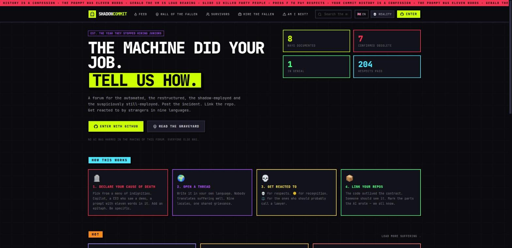

# ShadowCommit

[](https://github.com/cavelasquez17/shadowcommit/actions/workflows/ci.yml)
[](LICENSE)

**1000 ways the machine did your job. A support group with a database.**

ShadowCommit is a dark-humor social forum for developers displaced, restructured, or replaced by AI. Users declare a "cause of death" for their career, post threads in their own language, react with emoji-shaped screams, and link the repos that outlived their employment.



## What makes it different

No existing platform combines:
- A **career-obituary identity model** (cause of death, epitaph, fired-at timestamp, employed/denial status)
- A **multilingual forum** (18 post locales, 3 UI locales, filter by language)
- A **GitHub-native onboarding** (OAuth pulls repos, marks AI-written code)
- A **Wall of the Fallen** dashboard (aggregate stats by cause, seniority, country)
- A **neo-brutalist design language** (hard borders, offset shadows, neon-on-black, terminal grid)
- A **satirical tone** that punches up at executives and AI hype, not down at the unemployed

Reddit's r/Layoffs and r/singularity host scattered layoff stories. LinkedIn is a polished façade. No product gives displaced developers a dedicated, multilingual, darkly funny home with a data model built around career death.

## Status

Pre-release (`v0.1.0`), live at **https://shadow-commit.duckdns.org**. The deployment is real (HTTPS, GitHub
sign-in, automatic updates from the container registry) but the community is not: it is **invite-only and
empty**, with no users besides the maintainer. The project is under active development; what is planned is
tracked in the open issues, starting from the [roadmap](https://github.com/cavelasquez17/shadowcommit/issues/14).

## Architecture

```
shadowcommit/
├── api/          Go backend (Gin + GORM, SQLite/Postgres)
│   ├── cmd/api/          entry point, flags, scheduler wiring, health probe
│   └── internal/
│       ├── auth/         JWT issuer + GitHub OAuth
│       ├── config/       env-driven config
│       ├── handlers/     HTTP layer (thin Gin handlers) + static SPA serving
│       ├── jobs/         in-process scheduler: daily hot-score refresh, weekly digest
│       ├── models/       GORM schema (13 models)
│       ├── ranking/      the feed's hot-score formula
│       ├── seed/         reference data + demo personas
│       ├── store/        DB connection + migration + ID generation
│       └── testutil/     helpers shared by tests
├── web/          React 19 + TypeScript + Vite SPA
│   └── src/
│       ├── components/   Layout, ThreadCard, ReactionBar, Markdown, UI primitives
│       ├── lib/          api.ts (typed client), i18n.ts, format.ts (markdown renderer)
│       ├── locales/      en.json, es.json, pt.json
│       ├── pages/        Landing, Feed, ThreadDetail, NewThread, Profile, Members, Wall, Jobs, RiskCalculator, ...
│       └── store/        app.tsx (global context: session + meta + copium mode)
├── deploy/       production compose stack, Caddyfile, pull-based updater (+ tests), systemd units
├── scripts/      container smoke test
└── .github/      CI workflows and the pull request template
```


## Quick start

### API (Go 1.26+)

```bash
cd api
go run ./cmd/api              # SQLite at ./shadowcommit.db, port :8080
go run ./cmd/api -seed-demo   # + demo personas and threads (no-op if users exist)
go test ./... -race          # run all tests with the race detector
```

Key env vars: `PORT`, `APP_ENV`, `DB_DRIVER` (sqlite|postgres), `DATABASE_URL`, `JWT_SECRET`, `GITHUB_CLIENT_ID`, `GITHUB_CLIENT_SECRET`, `WEB_BASE_URL`, `CORS_ORIGINS`, `DEV_LOGIN` (dev only), `INVITE_ONLY`, `SEED_DEMO`.

### Web (Node 20+)

```bash
cd web
npm install
npm run dev      # Vite dev server at :5173, proxies /api to :8080
npm test         # Vitest + Testing Library
npm run build    # tsc + vite build → dist/
npm run lint     # oxlint
```

Set `VITE_API_BASE` to point the frontend at a non-local API.

For local sign-in without a GitHub OAuth app, start the API with `DEV_LOGIN=true` (development only; the
API refuses to boot with it in production).

### Run the production image

```bash
DOCKER_BUILDKIT=1 docker build -t shadowcommit .
docker run --rm -p 8080:8080 -e JWT_SECRET="$(openssl rand -hex 32)" -e SEED_DEMO=true shadowcommit
# open http://localhost:8080 (the API serves the built web app itself)
```

The image refuses to start in production without a real `JWT_SECRET`.

## Deployment

The app ships as a multi-arch container image (published to GitHub Container Registry by CI) and is
deployed pull-based behind Caddy for HTTPS. See [DEPLOY.md](DEPLOY.md) for the architecture, the
one-time host setup, how a release flows, rollback and troubleshooting.

## Privacy

Mood-entry photos are not implemented or collected yet. The planned safeguards and consent requirements
are documented in [PRIVACY.md](PRIVACY.md).

## Contributing

Issues and pull requests are welcome. [CONTRIBUTING.md](CONTRIBUTING.md) explains how to set up, what to run
before opening a pull request and how we work; the plan is in the open issues, starting from the
[roadmap](https://github.com/cavelasquez17/shadowcommit/issues/14). [AGENT.md](AGENT.md) holds the rules for
contributions made with an AI assistant.

## Design language

Neo-brutalist: dark void background with a faint terminal grid, hard 2px borders, offset box-shadows (no rounded corners, no gradients on structure). Color is semantic — toxic lime for CTAs, blood red for the fallen, cyber cyan for info, grape purple for mentions, butter yellow for highlights. Typography: Archivo Black for display, JetBrains Mono for body. Animations: glitch text-shadow, flicker opacity, marquee ticker.

## License

[MIT](LICENSE) © 2026 Carlos Velasquez.
